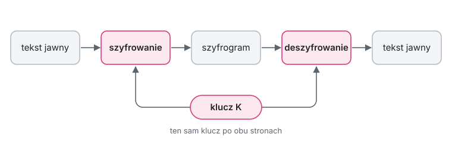

To jest notatka przykładowa. Pokazuje, jak wyglądają podstawowe elementy Markdowna, i można ją usunąć razem z pozostałymi przykładami.

## Tekst

Zwykły akapit z **pogrubieniem**, *kursywą*, ~~przekreśleniem~~ i [linkiem](https://pl.wikipedia.org/wiki/Kryptologia). Kod w linii wygląda tak: `sha256sum plik.iso`, a skrót klawiszowy tak: <kbd>Ctrl</kbd> + <kbd>C</kbd>.

Długie identyfikatory, na przykład `TLS_ECDHE_RSA_WITH_AES_256_GCM_SHA384`, łamią się i nie rozpychają strony na telefonie.

Przypisy też działają[^1].

### Nagłówek trzeciego poziomu

Nagłówki drugiego i trzeciego poziomu trafiają do spisu treści. Po najechaniu na nagłówek pojawia się link do sekcji.

#### Nagłówek czwartego poziomu

Niższe poziomy są widoczne tylko w treści.

## Listy

Lista nieuporządkowana:

- poufność
- integralność
  - sumy kontrolne
  - podpisy cyfrowe
- dostępność

Lista numerowana:

1. Zidentyfikuj zasoby.
2. Opisz zagrożenia.
3. Oszacuj ryzyko:
   1. prawdopodobieństwo,
   2. skutki.
4. Dobierz zabezpieczenia.

Lista zadań:

- [x] Przeczytać rozdział o szyfrach blokowych
- [x] Zrobić laboratorium z `openssl`
- [ ] Powtórzyć tryby pracy szyfrów

## Cytaty

> Bezpieczeństwo systemu powinno zależeć wyłącznie od tajności klucza, a nie od tajności algorytmu.
>
> Zasada Kerckhoffsa

## Bloki uwag

> [!NOTE]
> Zwykła uwaga z dodatkową informacją. W środku działa `kod`, **pogrubienie** i [linki](#tabele).

> [!TIP]
> Wskazówka. Hasła trzymaj w menedżerze haseł, a nie w pliku tekstowym.

> [!IMPORTANT]
> Ważna informacja, której nie warto pominąć przed kolokwium.

> [!WARNING]
> Ostrzeżenie. Tryb ECB zachowuje wzorce z tekstu jawnego.

> [!CAUTION]
> Poważne zagrożenie. Nie testuj narzędzi do skanowania na cudzej infrastrukturze.

> [!TIP] Własny tytuł
> Tekst po znaczniku zastępuje domyślny tytuł bloku.

## Tabele

| Algorytm | Rodzaj | Długość klucza | Uwagi |
| :-- | :-- | --: | :-- |
| AES | symetryczny, blokowy | 128, 192, 256 | Standard od 2001 roku |
| ChaCha20 | symetryczny, strumieniowy | 256 | Szybki bez wsparcia sprzętowego |
| RSA | asymetryczny | 2048 i więcej | Wolny, używany do wymiany kluczy i podpisów |
| Ed25519 | asymetryczny, podpisy | 256 | Krótkie klucze i podpisy |

Szersza tabela przewija się w poziomie, zamiast ściskać kolumny:

| Tryb | Wektor IV | Równoległe szyfrowanie | Równoległe deszyfrowanie | Uwierzytelnianie | Typowe zastosowanie |
| :-- | :-: | :-: | :-: | :-: | :-- |
| ECB | nie | tak | tak | nie | Nie stosować |
| CBC | tak | nie | tak | nie | Starsze protokoły |
| CTR | tak | tak | tak | nie | Szyfrowanie strumieni danych |
| GCM | tak | tak | tak | tak | TLS 1.3, dyski, komunikatory |

## Obrazki

Obrazek bez tytułu wyświetla się bez podpisu.

---

Pozioma linia oddziela luźno powiązane części notatki.

[^1]: Treść przypisu pojawia się na końcu notatki.
